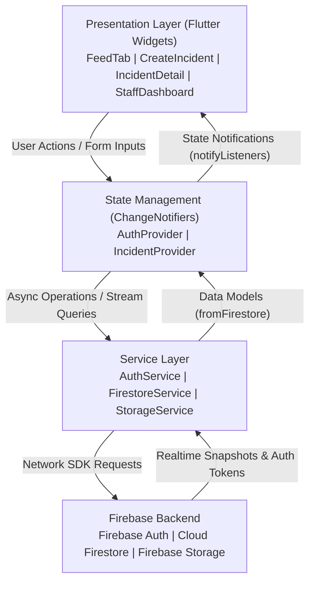
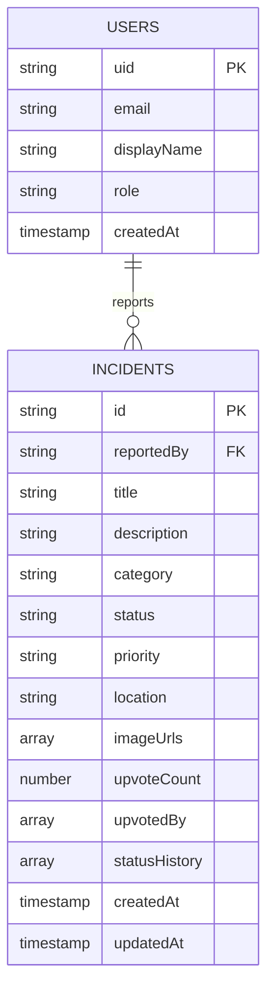

# Design and Implementation of a Mobile Campus Incident Reporting and Resolution Platform
## A Reactive, Role-Based System Utilizing Flutter, Provider State Management, and Firebase Backend Services

**Student Author:** [YOUR FULL NAME]  
**Course:** Mobile Application Development (Assignment 2)  
**Affiliation:** African Leadership University (ALU Rwanda)  
**Institutional Email:** [YOUR ALU EMAIL]  

---

### Project Deliverables & Demonstration Links
- **GitHub Repository Link:** [ADD YOUR REPOSITORY URL]
- **Demonstration Video Link (7-10 minutes):** [ADD YOUR VIDEO URL]
- **Submission Format:** Technical report (PDF), source code repository, demonstration video.

---

## Abstract
Prompt reporting and transparent tracking of campus infrastructure deficiencies (such as water shortages, power outages, sanitation failures, and damaged physical facilities) are paramount for sustaining a safe, productive higher education learning environment. Traditional reporting mechanisms—such as physical suggestion boxes, ad-hoc WhatsApp groups, or fragmented email chains—suffer from information loss, lack of accountability, and zero resolution transparency. This technical report presents the architectural design, security engineering, and implementation of the **ALU Campus Incident Reporter**, a cross-platform mobile application developed using Google Flutter. The system incorporates a Model-View-ViewModel (MVVM) architecture with Provider state management, integrated with Firebase Authentication, Cloud Firestore real-time NoSQL database, and Firebase Cloud Storage. A strict Role-Based Access Control (RBAC) model separates student capabilities (reporting, multimedia attachment, category filtering, search, and upvoting) from authorized campus staff privileges (status progression, priority triage, and resolution commentary). Security rules enforce institutional email domain validation (`@alustudent.com` and `@alueducation.com`) alongside mandatory email verification.

*Index Terms*— Flutter, Cloud Firestore, Firebase Authentication, Mobile Application Development, Role-Based Access Control (RBAC), Provider State Management, Incident Reporting, Campus Infrastructure.

---

## 1. Introduction & Campus Problem Formulation
Residential university campuses represent complex operational ecosystems comprising lecture halls, computer laboratories, residential halls, recreational complexes, and dining areas. Inevitably, physical facilities suffer wear, breakdowns, or sudden outages. At the African Leadership University (ALU) campus, students frequently encounter incidents such as:
1. **Water Shortages:** Sudden supply interruptions affecting student dormitories and cafeteria restrooms.
2. **Electricity Outages & Hazards:** Tripped circuit breakers, flickering study lamps, or exposed sockets in lecture halls.
3. **Broken Facilities:** Malfunctioning audio-visual projectors, doors that do not latch, or air conditioning units failure.
4. **Damaged Furniture:** Broken desk chairs in study carrels and lecture halls.
5. **Sanitation & Safety Concerns:** Spills requiring custodial cleanup or emergency exit obstructions.

Prior to this application, students reported incidents informally or walked to facility desks during restricted working hours. Consequently, facility managers struggled to gauge issue urgency, tickets were duplicated across multiple communication channels, and students had no visibility into whether their complaints had been received, dispatched, or resolved.

The **ALU Campus Incident Reporter** establishes a centralized, verifiable digital pipeline with the following objectives:
- **Standardized Data Capture:** Categories, campus locations, severity tiers, and photographic evidence.
- **Auditable Lifecycle Tracking:** Multi-stage status progression (*Pending* → *Under Review* → *In Progress* → *Resolved* / *Dismissed*) with timestamped staff commentary.
- **Institutional Access & Verification:** Mandatory authentication using official ALU domains (`@alustudent.com` or `@alueducation.com`) with email verification.
- **Democratic Priority Triage (Me-Too Upvotes):** Students can upvote active issues to reflect campus-wide impact.

---

## 2. System Architecture & State Management Approach

### 2.1 Clean MVVM (Model-View-ViewModel) Architecture
The codebase is structured according to the Clean Layered / MVVM design pattern:

```
campus_incident_reporter/
├── android/                   # Native Android container (minSdk 23, camera/storage permissions)
├── ios/                       # Native iOS container
├── lib/
│   ├── config/                # Constants (ALU domains, locations) & Theme (colors, typography)
│   ├── models/                # Immutable entities: UserModel & IncidentModel (with Firestore serializers)
│   ├── services/              # Remote backend services (AuthService, FirestoreService, StorageService)
│   ├── providers/             # ChangeNotifier ViewModels (AuthProvider, IncidentProvider)
│   ├── screens/               # Presentation Views (Splash, Auth, Home, Incident Management)
│   ├── widgets/               # Reusable atomic UI components (Badges, Chips, TextFields, Cards)
│   ├── firebase_options.dart  # Multi-platform Firebase credentials
│   └── main.dart              # Application entrypoint & Provider tree configuration
├── test/                      # Unit and widget test suite
├── firestore.rules            # Server-side Firestore role-based security rules
└── storage.rules              # Cloud Storage file size and authentication rules
```



### 2.2 State Management Rationale: Provider vs Alternatives
| Criterion | Provider (Selected) | setState() Alone | BLoC / Cubit | Riverpod |
| :--- | :--- | :--- | :--- | :--- |
| **Separation of Concerns** | High (Separates UI from business logic) | Poor (Tightly coupled inside State classes) | High (Event-driven) | High (Compile-safe providers) |
| **Boilerplate Overhead** | Low (Straightforward `ChangeNotifier`) | Minimal | High (Requires Events, States, Streams) | Medium |
| **Selective Re-rendering** | Excellent (`context.watch`, `context.select`) | Rebuilds entire widget subtree | Excellent | Excellent |
| **Asynchronous Stream Binding** | Native support with Firestore streams | Cumbersome manual subscription | Native via StreamBuilder | Native |
| **Official Recommendation** | Endorsed by Google Flutter team | Discouraged for app-wide state | Community standard | Community standard |

---

## 3. Firebase Backend Architecture & Data Design

### 3.1 Authentication & Email Verification
Registration requires an institutional email ending with `@alustudent.com` or `@alueducation.com`. The application dispatches an email verification link via `sendEmailVerification()`. An `EmailVerificationScreen` requires users to click the activation link before gaining dashboard access, preventing unverified or spam registrations.

### 3.2 Cloud Firestore NoSQL Collections
The database is structured into two root collections:
1. **`users` Collection**:
   - `uid` (Document ID matching Firebase Auth)
   - `email` (String, e.g. `jane.doe@alustudent.com`)
   - `displayName` (String)
   - `role` (String: `"student"` or `"staff"`)
   - `createdAt` (Timestamp)
   - `studentId` (String? for students) / `department` (String? for staff)
2. **`incidents` Collection**:
   - `id` (Auto-generated Firestore UUID)
   - `title` (String, max 100 characters)
   - `description` (String, max 1000 characters)
   - `category` (Enum: `brokenFacility`, `waterShortage`, `electricityOutage`, `damagedFurniture`, `sanitation`, `safety`, `network`, `other`)
   - `status` (Enum: `pending`, `underReview`, `inProgress`, `resolved`, `dismissed`)
   - `priority` (Enum: `low`, `medium`, `high`, `critical`)
   - `location` (String, designated campus facility)
   - `imageUrls` (Array of Firebase Storage HTTPS download URLs)
   - `reportedBy` (UID of author), `reporterName` (`"Anonymous"` when `isAnonymous` is true) and `isAnonymous` (Boolean). No email is stored on a report.
   - `createdAt` / `updatedAt` (Timestamps)
   - `upvoteCount` (Integer) & `upvotedBy` (Array of UIDs)
   - `statusHistory` (Array of Maps recording audit trail: `{status, updatedBy, updatedByName, updatedAt, comment}`)

### 3.3 Firebase Cloud Storage Workflow
Photographs are compressed to 82% quality (max 1200×1200 px) to conserve bandwidth. Files are stored at `incidents/{incidentId}/{uuid}.jpg` with metadata validation (`contentType: image/jpeg`). Secure HTTPS download URLs are referenced in the Firestore incident record. When an incident is deleted, `StorageService.deleteIncidentImages()` purges all associated photos.

---

## 4. Role-Based Access Control (RBAC) & Security Rules

Security is enforced at the database level using declarative rules:
- **Student Permissions**: Create new incidents, attach photos up to 5MB, browse the incident feed, search by keyword, filter by category/status, toggle upvotes on issues, and delete own reports while they are still pending.
- **Authorized Staff Permissions**: Access the **Staff Command Center**, transition incident statuses, update severity priority, assign technicians, append official resolution notes, and delete any inappropriate or resolved reports.

### Privacy & Misuse Prevention
- **Reporter email is never stored on a report.** Staff who need to follow up open a staff-only panel that reads the reporter's profile from `users`. The Firestore rules reject any report that contains a `reporterEmail` field, and students cannot read other users' profiles.
- **Anonymous reporting.** A student can switch on "Report anonymously" when submitting. The name stored on the report (and in its status history) is replaced by "Anonymous", so other students never see it. The rules enforce this too: if `isAnonymous` is true, `reporterName` must be "Anonymous".
- **Accountability for staff.** Anonymity is towards other students, not towards staff. This lets staff follow up and deal with false or abusive reports while still protecting reporters from peers. The form explains this before the student submits.

### Security Rules Summary
```javascript
// Excerpt from firestore.rules
function verifiedAlu() {
  return request.auth != null
    && request.auth.token.email_verified == true
    && (request.auth.token.email.matches('.*@alustudent[.]com')
        || request.auth.token.email.matches('.*@alueducation[.]com'));
}

match /users/{userId} {
  // Role must match the email domain: nobody can self-assign 'staff'.
  allow create: if request.auth.uid == userId
    && request.resource.data.role ==
         (request.auth.token.email.matches('.*@alueducation[.]com') ? 'staff' : 'student');
}

match /incidents/{incidentId} {
  allow read: if verifiedAlu();
  allow create: if verifiedAlu()
    && request.resource.data.reportedBy == request.auth.uid
    && request.resource.data.status == 'pending';
  allow update: if verifiedAlu() && (
    (isStaff() && changedKeys().hasOnly(['status','priority','assignedTo',
                                         'assignedToName','updatedAt','statusHistory']))
    || (resource.data.reportedBy == request.auth.uid
        && changedKeys().hasOnly(['imageUrls','updatedAt']))
    || /* upvote: only the caller's own uid added or removed */ isOwnUpvoteChange());
  allow delete: if verifiedAlu() && (isStaff()
    || (resource.data.reportedBy == request.auth.uid && resource.data.status == 'pending'));
}
```
The full rules are in `firestore.rules` and `storage.rules`. Role checks are enforced on the server as well as hidden in the UI, so a modified client cannot change a status or promote itself.

---

## 5. UI/UX Decisions, Design System & Accessibility

1. **Color-Coded Status & Priority Taxonomy**:
   - Pending: Orange (`#FFA726`)
   - Under Review: Blue (`#42A5F5`)
   - In Progress: Purple (`#7E57C2`)
   - Resolved: Green (`#66BB6A`)
   - Critical Urgency: Red (`#E53935`)
2. **Category Chip Bar**: Horizontal scrolling bar with Material design icons (e.g., build, water drop, bolt, chair, cleaning services, warning, wifi) enables 1-tap categorization.
3. **Resolution Progress Timeline**: Displays step-by-step progress on each ticket with timestamps, staff names, and comments.
4. **Interactive Image Viewer**: Pinch-to-zoom full-screen preview for attached photographs.
5. **Defensive Feedback**: Modal loading overlays prevent duplicate submissions during network operations.

---

## 6. Testing Strategy & Quality Assurance

Automated tests live in `test/` and run with `flutter test` without needing Firebase:
- **Model tests**: role assignment for `UserModel` and display names for `IncidentModel` enums.
- **Validator tests** (`validators_test.dart`): ALU email domains (including look-alike domains), password length, and incident title and description limits.
- **Provider tests** (`incident_provider_test.dart`): the provider is tested against in-memory fakes of the Firestore and Storage services. They cover the loading state, keyword search, combined category and status filters, the open report refreshing when a new snapshot arrives, a failed status update returning `false` with an error, rollback of a report when its photo upload fails, and clearing all data on sign-out.
- **Widget tests**: `StatusBadge` and `CategoryChip` rendering.

**Manual testing:** [Describe the manual tests you actually ran on the Android emulator or device against your Firebase project, and what you observed. Suggested checks: registration with a non-ALU email is rejected; login is blocked until the email is verified; submitting a report with and without photos; search and filters; a staff status update appearing on the student's screen; a student attempting a staff action and being denied; and the Rules Playground results. Add a screenshot of `flutter test` passing.]

---

## 7. Challenges Encountered & Engineering Solutions

1. **Reports and photos in two steps**:
   - *Issue*: Uploading photos before the report exists risks orphaned files, but creating the report first risks a report without its photos.
   - *Solution*: The report is created first to get its ID, photos go to `incidents/{id}/`, and the URLs are written back. If any step fails, the report and its photos are removed and the user sees an error.
2. **Email verification and security rules**:
   - *Issue*: The rules read `email_verified` from the ID token, which stays `false` after the user clicks the link until the token refreshes.
   - *Solution*: After `reload()` the app forces `getIdToken(true)`, so verified users are not rejected by Firestore.
3. **Staying honest about failures**:
   - *Issue*: An early version caught Firebase errors and carried on with local placeholder data, which hid broken writes.
   - *Solution*: All fallbacks were removed. Services throw, providers return `false` and set an error message, and screens show it.
4. **Role security**:
   - *Issue*: Deriving the role on the client alone would let a modified app grant itself staff access.
   - *Solution*: The rules force the role to match the verified email domain, forbid role changes, and limit what each role may update.

---

## 7.1 Limitations & Future Work
- Staff are recognised by the `@alueducation.com` domain; finer roles (for example per-department staff) would need custom claims set by an admin function.
- Anonymous reports still store the opaque author UID, which is needed for "My Reports", ownership rules and staff follow-up. Students cannot map that UID to a person because the `users` collection is not readable by them, but staff can.
- No push notifications when a status changes, and filtering is done on the device, which is fine for campus-scale data but would need server-side queries at larger scale.
- Firestore rules are checked manually; automated rules tests with the Firebase emulator would be a good addition.

---

## 7.2 Screenshots & Diagrams
[Insert screenshots from your own emulator: login and verification, submit report, feed with filters, report detail with timeline, staff dashboard and status dialog, and the Firebase Console views of `users`, `incidents` and the Storage bucket.]



---

## 8. Demonstration Video Outline (7–10 Minutes)

| Timestamp | Video Section | Narration & Demonstration Action |
| :--- | :--- | :--- |
| **0:00 – 1:15** | App Overview & Architecture | Introduce the campus problem, the Provider architecture, and the Firebase integration. |
| **1:15 – 2:45** | Authentication & Domain Check | Register with non-ALU email (shows rejection); register with `@alustudent.com`; demonstrate email verification screen; sign in. |
| **2:45 – 4:15** | Submitting an Incident | Student reports "Water Shortage" in "Dormitory Block B", enters description, selects High priority, attaches photo from gallery, and submits. |
| **4:15 – 5:30** | Feed, Search & Filters | Browse feed; filter by category chips; filter by status; search for "water"; demonstrate "Me-Too" upvote counter. |
| **5:30 – 7:15** | Staff Role & Status Update | Sign out and sign in with a staff account (`@alueducation.com`); open Staff Command Center; review pending triage; update status to "In Progress" with note "Plumbing team dispatched"; inspect updated resolution timeline. |
| **7:15 – 8:30** | Firebase Console Verification | Show real-time updates in Cloud Firestore collections (`users`, `incidents`), Firebase Storage bucket, and code walkthrough in IDE. |

---

## 9. Conclusion
The **ALU Campus Incident Reporter** demonstrates how modern cross-platform mobile development (Flutter + Provider) combined with scalable serverless infrastructure (Firebase Auth, Cloud Firestore, Firebase Storage) can transform campus operational management. The application enforces strong institutional security, guarantees accountability through an auditable status history, and provides a delightful, accessible user experience.

---

## 10. References
1. E. Windmill, *Flutter in Action*, Shelter Island, NY: Manning Publications, 2020.
2. Google Developers, "Firebase Documentation: Cloud Firestore, Authentication, and Cloud Storage for Flutter," *Google Cloud*, 2024. [Online]. Available: https://firebase.google.com/docs/flutter/setup.
3. R. Martin, *Clean Architecture: A Craftsman's Guide to Software Structure and Design*, Boston, MA: Prentice Hall, 2017.
4. Flutter Community, "Provider Package Documentation and State Management Architecture," *Pub.dev*, 2024. [Online]. Available: https://pub.dev/packages/provider.
5. IEEE Computer Society, *IEEE Standard for Software Quality Assurance Processes*, IEEE Std 730-2014, 2014.
